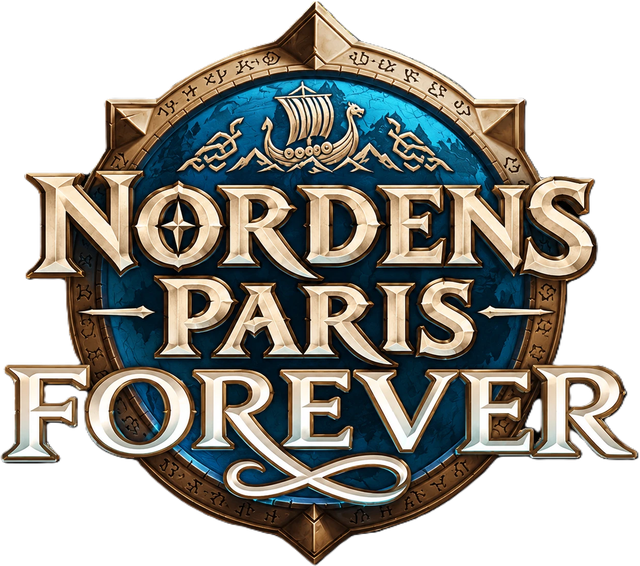

<p align="center"></p>

# Nordens Paris – tools & addons

Fælles samling af værktøjer og addons, som folk i guilden **Nordens Paris** har lavet (ofte vibecodet med AI). Alt her er gratis, open source og til hele guilden, på tværs af raidhold.

> Ikke tilknyttet Blizzard Entertainment. Brug alt her på eget ansvar.

## Indhold

| Projekt | Hvad det gør | Platform | Hent |
|---|---|---|---|
| [WoW Queue Watcher](tools/wow-queue-watcher) | Overvåger login-køen og sender alarmer til din telefon | Windows, Python | [Releases](https://github.com/nordens-paris/tools/releases?q=queue-watcher&expanded=true) |
| [UI-overførsel](tools/wow-ui-transfer) | Flytter addons, keybinds, macros, Edit Mode og chat fra Beta til din nye character på launch | Windows, PowerShell | [Releases](https://github.com/nordens-paris/tools/releases?q=ui-overfoersel&expanded=true) |
| [NP Roster](tools/raid-roster) | Planlægger raid-rosters ud fra Raid-Helper: buffs, grupper, bænk-rotation og fremmøde | Web (Claude-artifact) | Link fra Darkfade (officerer) |
| [NPRoster-addon](addons/NPRoster) | Importerer rosteret i spillet: invitér, sortér grupper, bænk-whispers og fremmøde | WoW-addon | [Releases](https://github.com/nordens-paris/tools/releases?q=np-roster&expanded=true) |
| [Darkfade's Forever Warrior](addons/darkfade-forever-warrior) | Komplet WeakAura-UI til Warrior: cooldowns, procs, swing og Rage, Battle Shout-påmindelser og tank-announces | WeakAura (ForeverAuras) | [Import-streng](addons/darkfade-forever-warrior/Darkfade-Forever-Warrior.txt) |

Hvert værktøj har sine egne versioner. Linkene under **Hent** viser kun det værktøjs releases, med den nyeste øverst.

## Sådan hentes et værktøj

- **Færdige versioner** (zip, exe) ligger under [Releases](https://github.com/nordens-paris/tools/releases).
- **Kildekoden** ligger i mappen for hvert projekt. Tryk **Code → Download ZIP** for at hente hele repoet.

Kør kun ting, du har hentet herfra eller fra en Release, ikke filer sendt rundt i Discord.

## Struktur

```
tools/     Programmer og scripts, der kører uden for spillet
addons/    WoW-addons (Interface\AddOns) og WeakAura-packs (import-strenge)
```

Hvert projekt har sin egen mappe med en `README.md`, der forklarer, hvad det gør, hvordan man installerer det, og hvem der vedligeholder det.

## Fejl, idéer og spørgsmål

- **Noget virker ikke, eller har du en idé?** Opret et [issue](https://github.com/nordens-paris/tools/issues/new/choose).
- **Spørgsmål og snak** hører til i [Discussions](https://github.com/nordens-paris/tools/discussions).

## Vil du bidrage?

Send dit GitHub-brugernavn til Darkfade på Discord, så bliver du inviteret. Læs derefter [CONTRIBUTING.md](CONTRIBUTING.md).

Kort sagt: én mappe pr. projekt, ingen personlige data eller hemmeligheder, og alt kommer ind via en pull request, som en code owner skal godkende. Kun owners udgiver releases.

## Licens

[MIT](LICENSE), medmindre et projekts egen mappe siger andet.
