# Parse Mirror

**Se hvad de bedste gør anderledes, og hvad det er værd i DPS.**

Parse Mirror tager et boss-kill fra Warcraft Logs og sammenligner det med de bedste parses i din
spec på samme boss. WoWSims regner ud, hvor meget af forskellen der er gear, raid buffs,
kill-tid, spil og held, og hvad du skal rette først.

Lavet af Nordens Paris som proof of concept til **WoW Forever**. I dag kører det på TBC
Anniversary (fresh.warcraftlogs.com), fordi det er der, logs og sim findes.

**Understøttede specs:** Fury Warrior, Destruction Warlock, Arcane Mage, Shadow Priest.
**Healere:** Holy og Discipline Priest, Holy Paladin, Restoration Shaman og Restoration Druid,
sammenlignet med healere fra velspillede raids ([afsnit 9](#9-healere)).

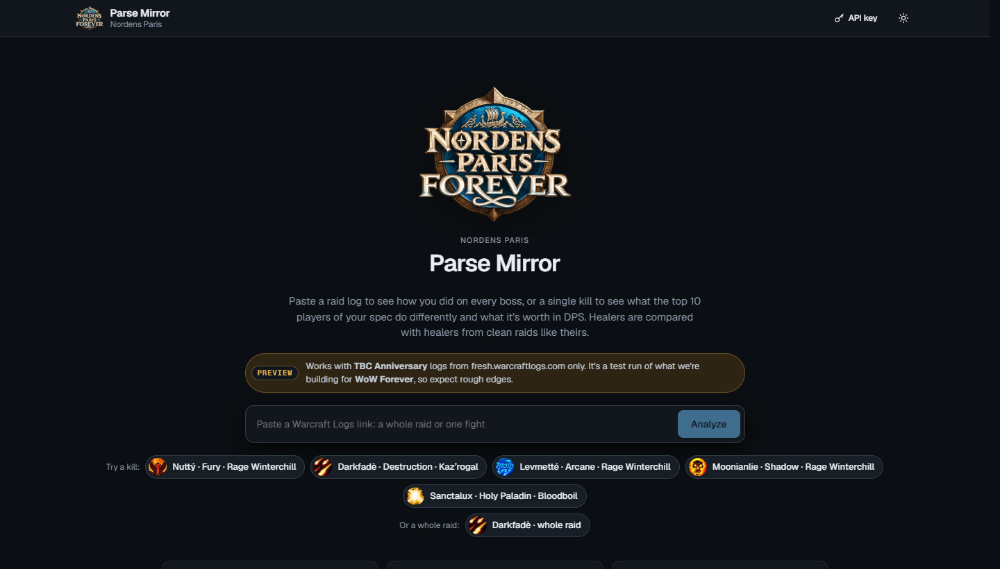

---

## Brugervejledning

### 1. Indsæt et loglink

Åbn din log på Warcraft Logs, klik på din karakter, og kopiér adressen. Indsæt den på forsiden og
tryk **Analyze**. Hvad du får, afhænger af linket:

| Link indeholder | Du får |
|---|---|
| `fight=` og `source=` | Ét kill sammenlignet med top 10 (det meste af denne vejledning), eller for en healer med healere fra velspillede raids ([afsnit 9](#9-healere)) |
| kun `source=` | Din raid: DPS og parse på hver boss ([afsnit 8](#8-hele-raidet)) |
| kun rapporten | Alle spillere på alle bosses ([afsnit 8](#8-hele-raidet)) |

Første analyse af et kill tager 10–30 sekunder at hente. Sims kører derefter i din egen browser
og tager 10–40 sekunder afhængigt af computeren (første gang hentes simmen, 7 MB). Knapperne under feltet åbner eksempler fra guilden.

### 2. Overblik: hvad skal jeg rette først?

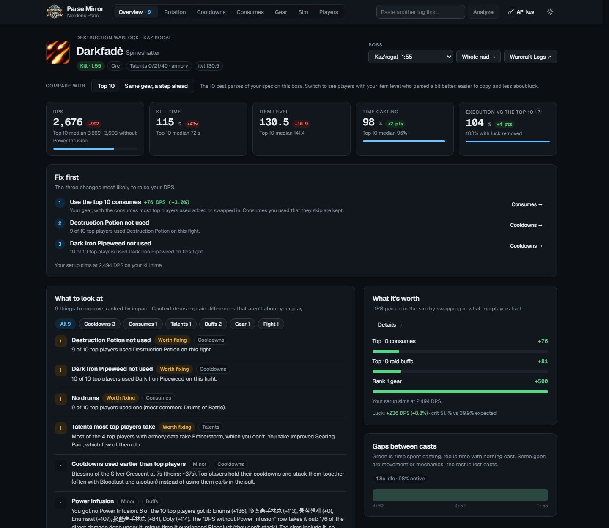

Øverst står kampen og dine nøgletal mod top 10's median: DPS, kill-tid, item level, tid brugt på
at caste (eller GCD-brug for melee) og **execution**, altså hvor godt du spillede dit eget setup
(se [afsnit 5](#5-sim-hvad-er-forskellen-værd)).

Menuen **Boss** ved siden af skifter til en anden boss i samme raid for den samme spiller (kills
først, derefter wipes), så du kan gå bosserne igennem uden at indsætte et nyt link.

**Fix first** er de tre ting, der mest sandsynligt hæver din DPS: top 10's consumables, hvis
simmen måler en reel gevinst, og derefter de største fund. Knappen til højre åbner fanen med
detaljerne.

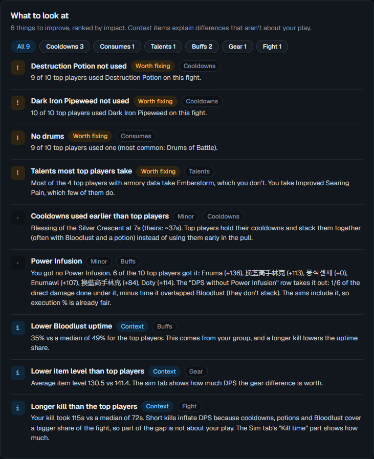

**What to look at** er alle fund rangeret efter betydning. "Big impact" og "Worth fixing" er ting
du selv kan ændre; "Context" forklarer forskelle, der ikke handler om dit spil (længere kill,
raid buffs du ikke havde, Power Infusion fra en præst). Filtrér på område med knapperne.

### 3. Rotation

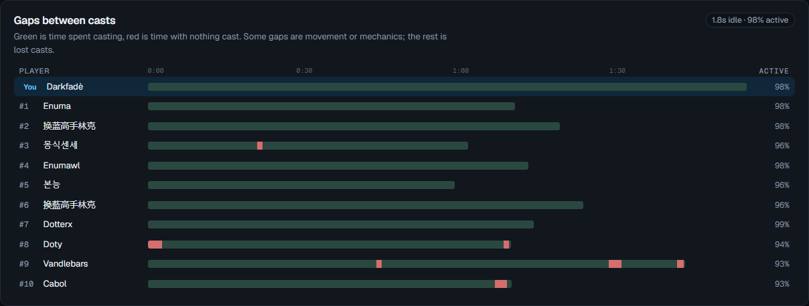

**Gaps between casts** viser hele kampen for dig og top 10 på samme tidsakse: grønt er tid, hvor
du castede, rødt er huller. Noget er bevægelse og mekanik; resten er tabte casts. Dine længste
huller står under grafen.

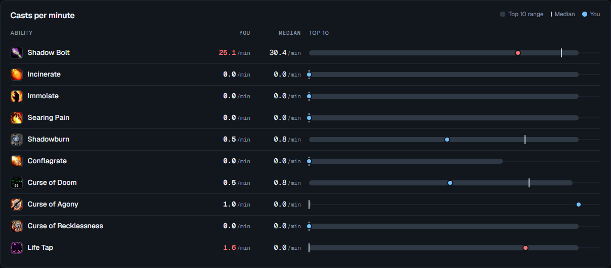

Tabellerne viser **cast efficiency** (casts af kerne-abilities mod det maksimalt mulige),
**casts pr. minut** og **uptimes**. Den grå bjælke er top 10's spænd, stregen deres median, og
prikken dig (grøn er godt, rød er værd at se på). Hold musen over en bjælke for hver spillers tal.

### 4. Cooldowns og consumables

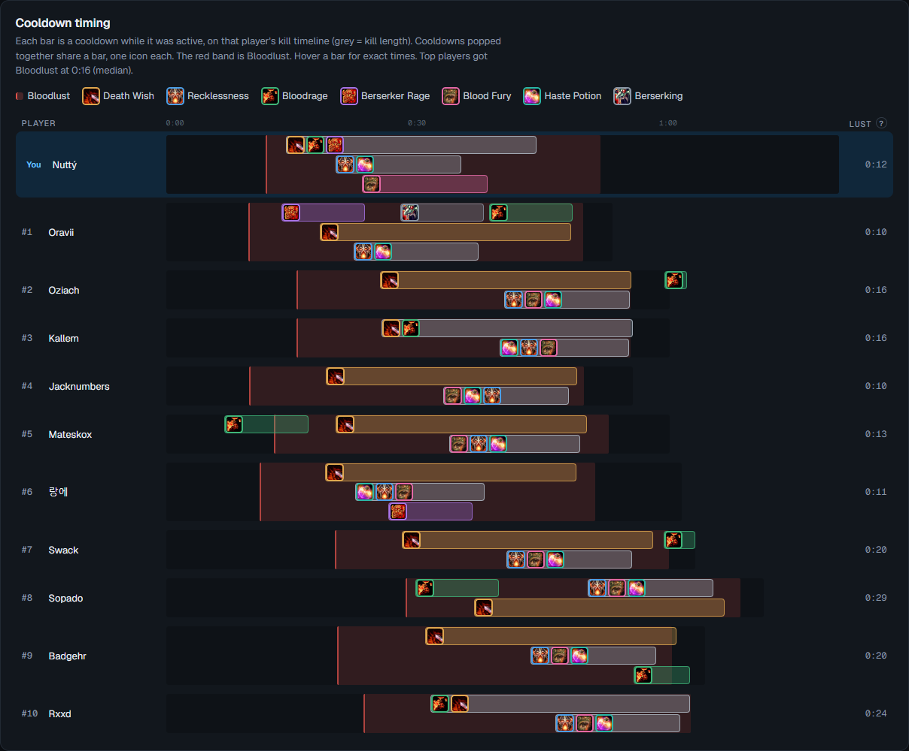

**Cooldown timing** viser hver spillers cooldowns som bjælker på deres egen kamp. Cooldowns
brugt sammen deler en bjælke. Det røde bånd er Bloodlust, og kolonnen til højre viser, hvornår
den kom. Brugte du dine cooldowns tidligere end top 10, eller uden at stable dem med Bloodlust,
står det også som et fund.

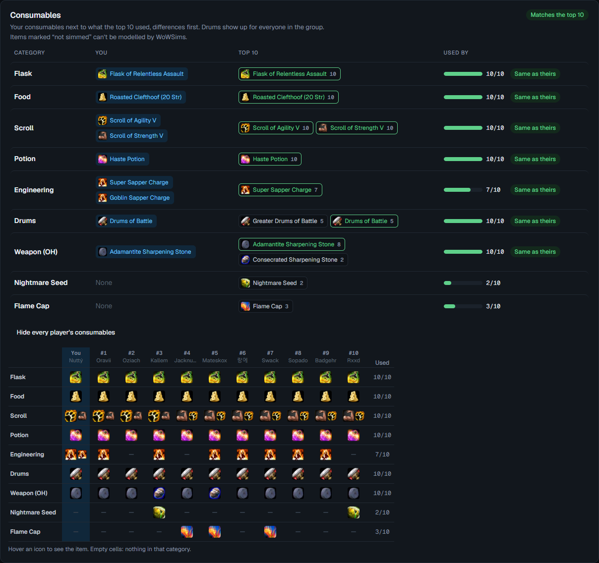

**Consumables** viser pr. kategori, hvad du brugte, hvad top 10 brugte, og hvor mange af dem der
brugte noget. Forskellene står øverst. "Show every player's consumables" viser alle spillere side
om side.

### 5. Sim: hvad er forskellen værd?

Sim-fanen kører WoWSims på dit setup, i din egen browser. Den starter automatisk, viser hvor
mange sims der er færdige, og prikken på fanen forsvinder, når den er klar.

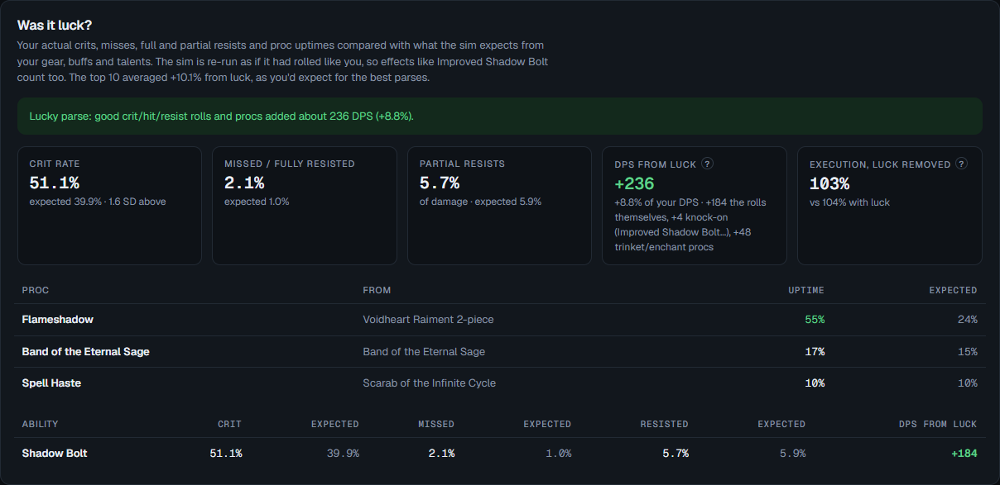

**Was it luck?** sammenligner dine crits, miss, resists og proc-uptimes med det, simmen forventer
for præcis dit gear og dine buffs, og omregner det til DPS. De bedste parses er næsten altid
heldige: rankings viser hver spillers *bedste* kill ud af mange.

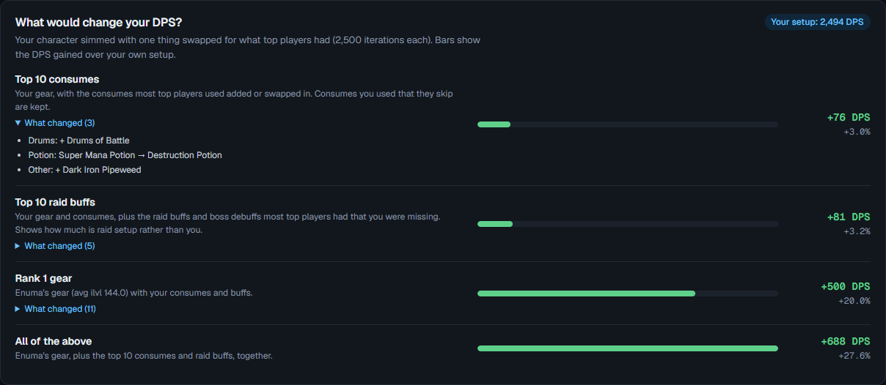

**What would change your DPS?** simmer din karakter med én ting byttet ud ad gangen: top 10's
consumables, deres raid buffs, rank 1's gear, og det hele samlet. "What changed" viser præcis hvad
der blev byttet, så du ved hvad du skal skaffe. Consumables og raid buffs lægges kun til; der
fjernes aldrig noget, du havde.

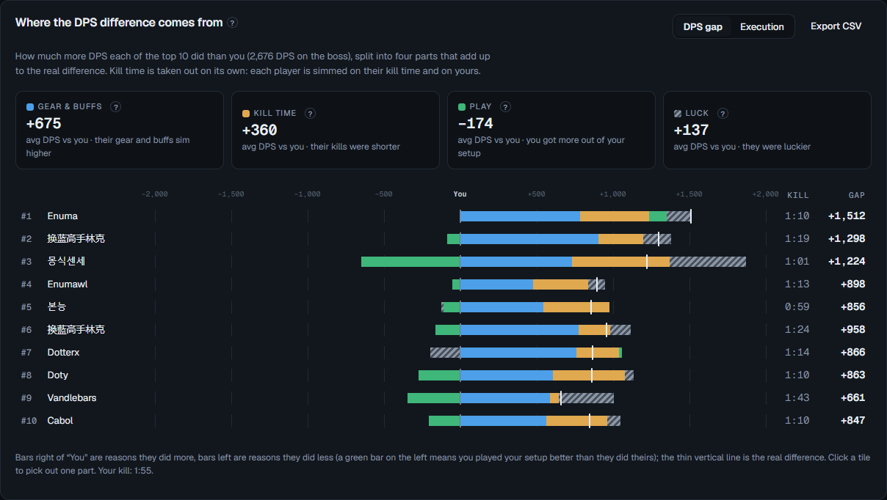

**Where the DPS difference comes from** deler hver top-spillers forskel til dig i fire dele, der
lægger sig præcist sammen:

- **Gear & buffs** (blå): hvad deres gear, talenter, consumables og raid buffs er værd over dine,
  på din kill-tid.
- **Kill time** (gul): hvor meget deres kortere (eller længere) kill ændrer simmens tal. Korte kills
  giver højere DPS, fordi cooldowns og Bloodlust dækker mere af kampen.
- **Play** (grøn): hvor meget mere af deres setups simmede DPS de fik ud af det end dig, med held
  fjernet. En grøn bjælke til venstre betyder, at du spillede dit setup bedre, end de spillede deres.
- **Luck** (skraveret): deres held minus dit.

Bjælker til højre for "You" er grunde til, at de lavede mere; til venstre grunde til, at de lavede
mindre. Den tynde lodrette streg er den rigtige forskel. Klik på en af de fire bokse for at
fremhæve den del.

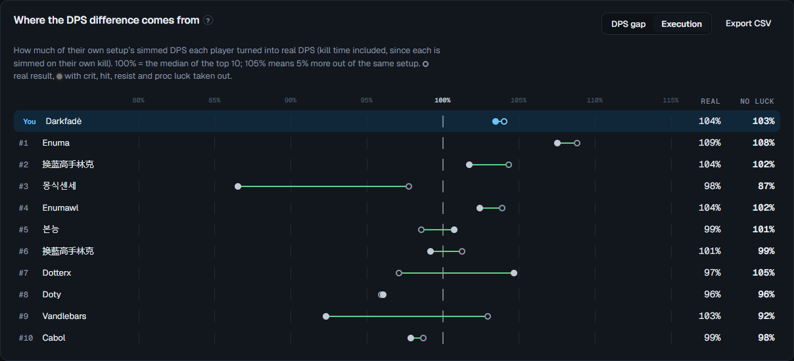

**Execution**-visningen viser, hvor meget af sit eget setups simmede DPS hver spiller fik ud af
det. 100 % er medianen; 105 % betyder 5 % mere ud af samme setup. Ringen er det rigtige resultat,
prikken er med held fjernet.

### 6. Gear og hit

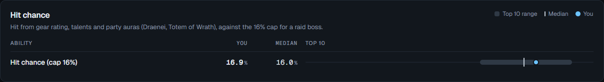

**Hit chance** er hit fra gear plus talenter og party-auras (Draenei, Totem of Wrath), mod hit-cap
for en raid-boss. Under cap koster miss; langt over er rating, der kunne have været andre stats.

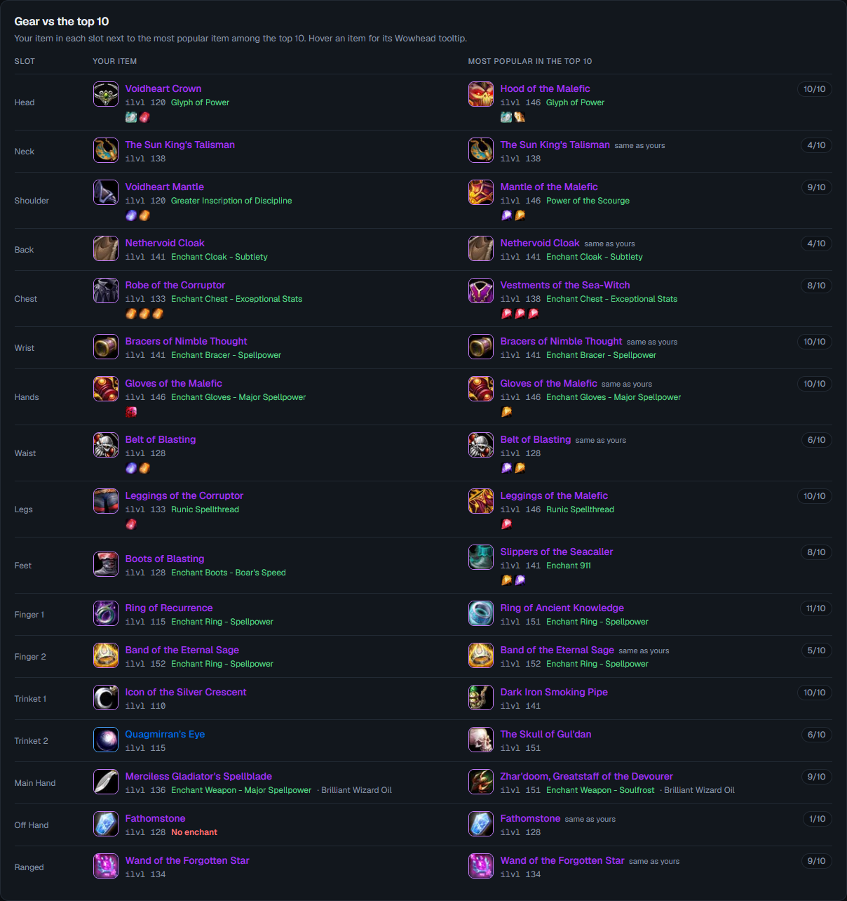

**Gear** viser dit item i hver slot ved siden af det mest populære blandt top 10, med enchants og
gems. Hold musen over et item for Wowhead-tooltip. Manglende enchants står også som fund.

### 7. Sammenlign med "Same gear, a step ahead"

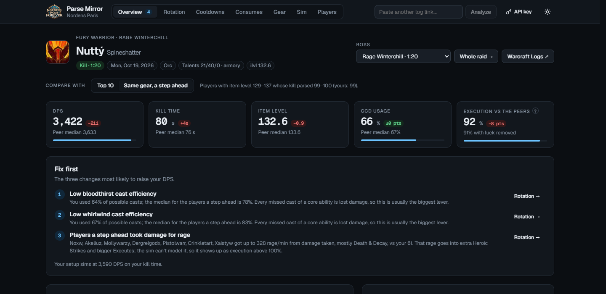

Top 10 har ofte langt bedre gear og meget held. Vælg **Same gear, a step ahead** for i stedet at
se spillere med cirka dit item level (±4, eller ±8 hvis der er for få), hvis kill parsede lidt
bedre end dit og slog din DPS. Alle faner skifter til den gruppe, og ordene skifter til "peers".
Det er lettere at kopiere og mindre præget af held.

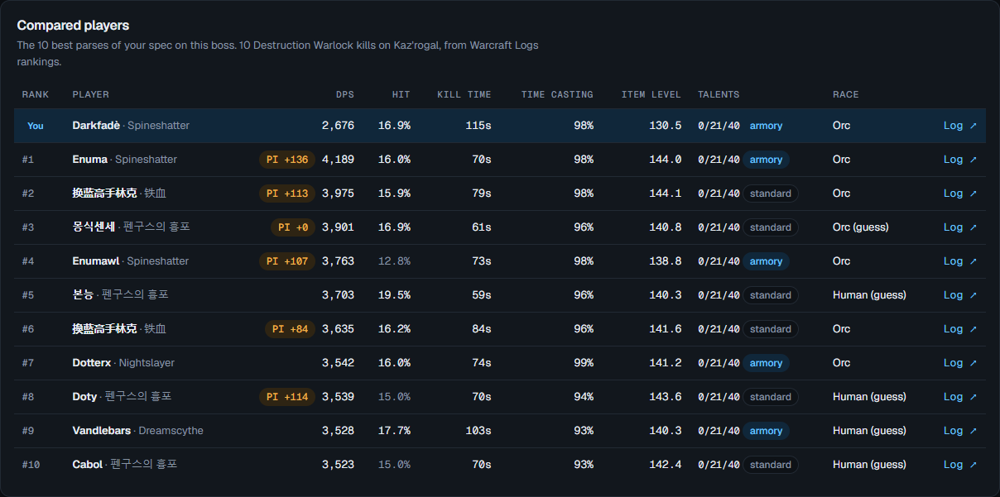

**Players** viser hvem du sammenlignes med: DPS (med Power Infusion markeret), hit, kill-tid,
item level, talenter og et link til hver log.

### 8. Hele raidet

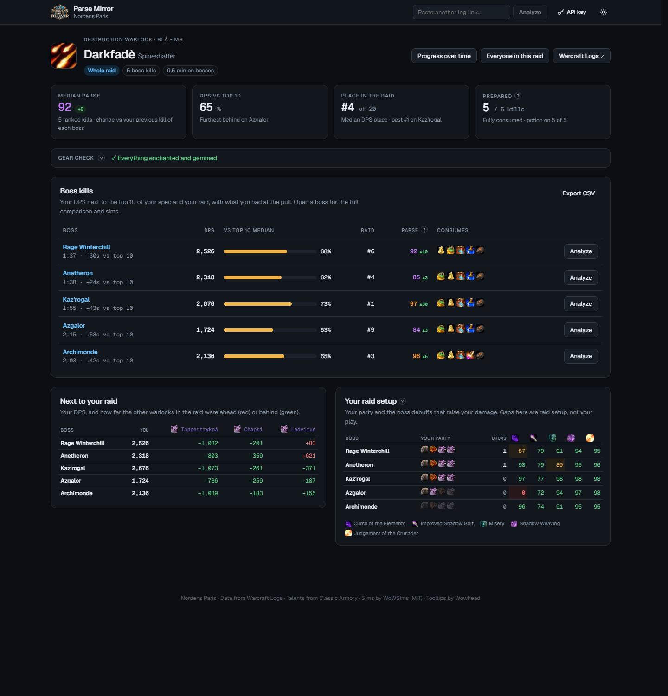

Med et link med kun `source=` får du **din raid**:

- **Nøgletal:** median parse (og ændringen fra dine forrige kills af hver boss), DPS i procent af
  top 10, din plads i raidet blandt DPS'erne, og hvor mange kills du var fuldt forberedt.
- **Gear check** på én linje: manglende enchants, tomme sockets, grønne gems og hit under cap.
- **Boss kills:** DPS mod top 10's median, din plads i raidet, parse med ▲/▼ mod dit forrige kill
  af bossen (hold musen over for forrige kill og din bedste parse), og consumables som ikoner,
  med rødt hvis noget manglede. **Analyze** åbner den fulde sammenligning for en boss.
- **Next to your raid:** din DPS ved siden af raidets andre af samme klasse (eller raidets top tre
  med samme slags skade, hvis du er den eneste), som forskel pr. boss.
- **Your raid setup:** din party pr. kill (klasseikoner; svage ikoner er gættet), drums, og uptime
  for de boss-debuffs, der hæver netop din skade. Huller her er raidets setup, ikke dit spil.

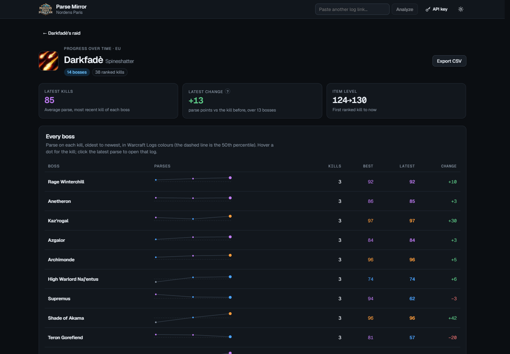

**Progress over time** viser dine parses på hver boss i raid-tieret, kill for kill.

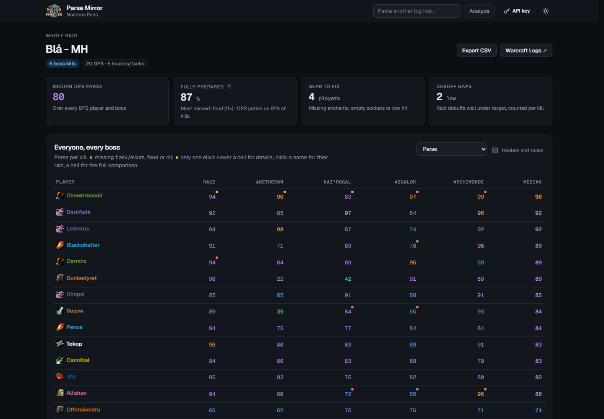

**Everyone in this raid** (eller et rent rapportlink) er en officer-rapport for hele raidet:

- **Everyone, every boss:** parse pr. kill. En rød prik betyder manglende flask/elixirs, food eller
  olie; en gul prik, at spilleren kun havde én elixir. Menuen skifter til consumables som ikoner:
  alle på én gang, eller kun flask & elixirs, food, våbenolie/-sten, scrolls eller potions & runes.
  Rødt felt er noget, der manglede (for potions: en DPS-spiller uden), gult kun én elixir.
- **Debuffs on the boss:** uptime pr. kill for de debuffs raidet kan bringe (Sunder/Expose Armor,
  Curse of the Elements, Misery, Improved Shadow Bolt …). De hæver alles skade, så huller her koster
  hele raidet. Lav på alle debuffs for én boss betyder som regel, at bossen ikke kunne angribes en
  del af kampen.
- **Parties:** hvem der var i hvilken gruppe på hvert kill, med drums og noter, f.eks. melee uden en
  shaman (ingen Windfury), casters uden Wrath of Air, eller en shadow priest, hvis mana ikke rammer
  nogen. Grupperne findes ud fra drums, Vampiric Touch-mana og party-auras. Spillere, loggen ikke
  kan placere, sættes ind på et gæt (i en gruppe med plads og samme rolle) og vises i kursiv med
  "?"; noterne regner kun med de spillere, der er sikre.
- **Gear check:** manglende enchants, tomme sockets, grønne gems og hit under cap (for de
  understøttede specs) fra hver spillers seneste kill.

Det hele kan eksporteres som CSV.

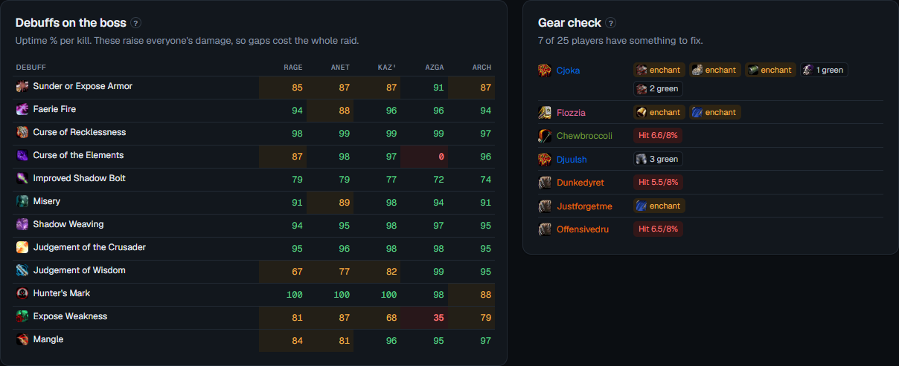

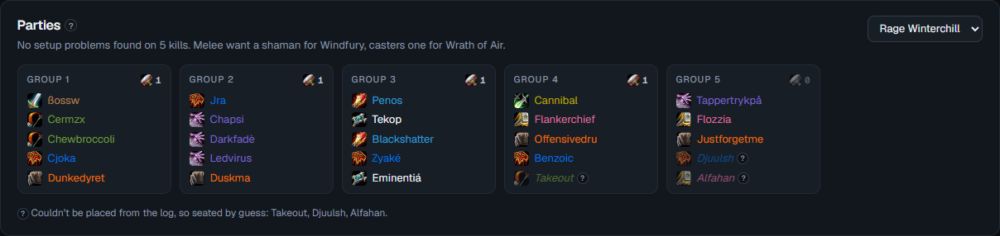

### 9. Healere

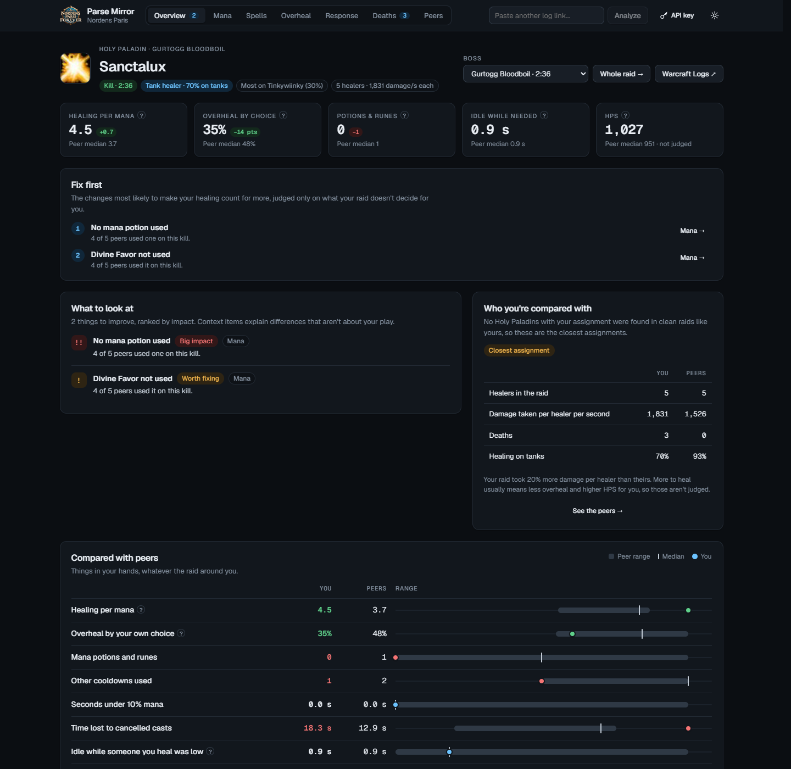

Warcraft Logs' healing-parse måler kun, hvor meget du healede. Det afhænger mest af raidet omkring
dig: med færre healere eller svage med-healere er der mere at hele. Indsætter du et kill, hvor du
healede, får du i stedet en sammenligning, der kun bedømmer det, du selv bestemmer.

**Hvem du sammenlignes med.** Fem healere med samme spec og samme opgave (mest tanks, mest raid
eller begge dele), fundet i *velspillede* raids: Warcraft Logs' execution-rangering (renest kill:
lidt skade, få dødsfald) og speed-rangering (hurtigst) for bossen. Raidet skal have samme antal
healere som dit og cirka samme skade pr. healer, og healeren skal parse mindst middel over sine
kills i tieret (rigtig mange healere parser lavt, så middel er allerede stabilt). Mærket øverst
siger, hvor tæt det passer: **Close match**, **Looser match** (±1 healer eller ±40 % skade) eller
**Closest assignment** (ingen med din opgave fandtes, så de nærmeste).

**Hvad der bedømmes, og hvad der kun er kontekst.** Healing per mana (også pr. spell), overheal du
selv valgte, potions, runes og cooldowns, tid under 10 % mana, tid tabt på afbrudte casts, tid uden
at caste mens nogen, du healer, var under 70 %, reaktionstid, saves og præ-heals på tanks bliver
sammenlignet. HPS, andel af raidets healing, samlet overheal og mana tilbage er kun kontekst, fordi
de afhænger af raidet. Øverst står også raidets antal healere og skade pr. healer ved siden af
dit.

**Fanerne:**

- **Overview:** Fix first, fund, hvem du sammenlignes med, og alle tal mod peers.
- **Mana:** mana-kurven mod peers (strakt til samme længde), hvornår du brugte cooldowns og potions
  og med hvor meget mana, og hvor manaen kom fra.
- **Spells:** andel af din healing, healing per mana og overheal pr. spell, mod peers.
- **Overheal:** overheal delt i fem årsager. Kun **your choice** er din: healet var allerede større
  end det manglende liv, da du begyndte at caste (eller da en instant landede). Andre healere, der
  nåede først, Chain Heal-hop, HoT-ticks på fuldt liv og procs (Prayer of Mending, Earth Shield)
  tælles for sig.
- **Response:** reaktion, saves, tomgang og afbrudte casts. Et afbrudt cast, hvor spilleren allerede
  var fyldt op, er markeret som sandsynligt bevidst (det sparer mana).
- **Deaths:** hvert dødsfald med HP de sidste sekunder, skaden og hvad hver healer castede. **Burst**
  (fra 60 %+ i ét hit) og **fast** (under 2 sekunder under 50 %) kunne ingen nå; kun **time to
  save** siger noget om healingen. Evner på en timer markeres.
- **Peers:** de fem healere, deres raid (placering, healere, skade pr. healer, dødsfald) og links
  til deres logs.

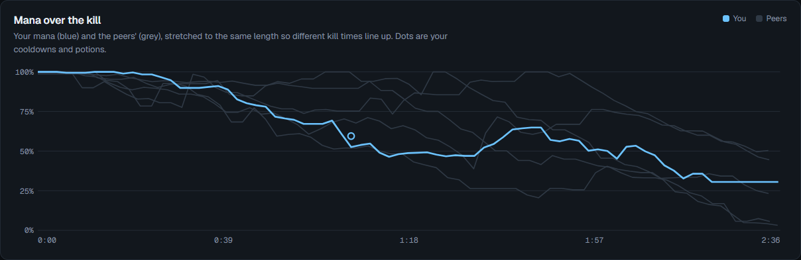

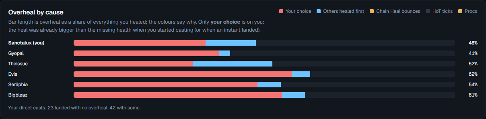

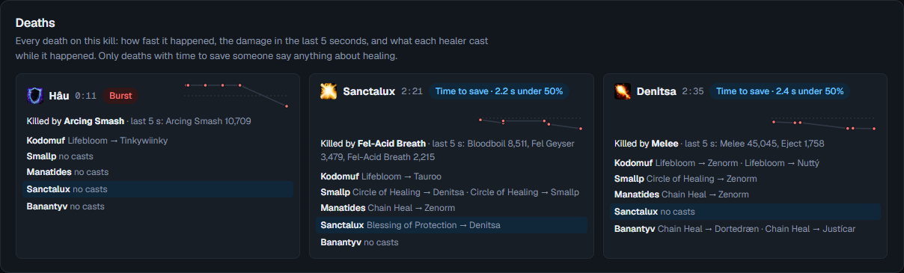

**Raid-siderne:** en healers egen raid viser healing per mana, overheal, mana tilbage, potions og
tomgang pr. boss. På **Everyone in this raid** henter **Show healers** alle healere på alle bosses
(det tager lidt tid første gang).

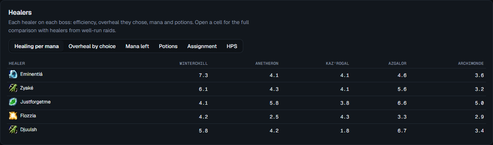

**Godt at vide om healere:** HP står i procent i loggene, så maksimalt liv regnes ud fra store hits
(eller stamina, ±7 %). Et påbegyndt cast har intet mål i loggen, så et afbrudt cast kan ikke
bedømmes sikkert. WoWSims kan ikke simme healere, så der er ingen what-ifs. Første healer-analyse
af et kill henter omkring 50–60 kald fra Warcraft Logs; derefter deles det meste gennem cachen. Derfor
kræver healer-siderne på den hostede side din egen Warcraft Logs-nøgle (**API key** øverst til
højre); den bliver i din browser.

### 10. Del og gem

- Hver visning har sin egen adresse, så du kan dele et link på Discord, og tilbage-knappen virker.
  `&vs=peers` vælger "Same gear, a step ahead", `&tab=Sim` åbner en bestemt fane.
- Forsiden tilbyder at fortsætte, hvor du slap.
- **API key** øverst til højre viser forbruget af Warcraft Logs-kvoten, og lader dig bruge din egen
  nøgle, hvis serverens er brugt op. Din nøgle gemmes kun i din browser og sendes kun med dine egne
  forespørgsler; serveren gemmer eller logger den aldrig.
- Solen/månen skifter mellem lyst og mørkt tema.

### Godt at vide

- Sammenligningen er mest retvisende på single-target-bosses. Bosser med adds eller pauser
  (Council, Illidan, Reliquary, Akama) kan ikke simmes rimeligt.
- Totems og selv-buffs (Fel Armor, Shadowform, Mage Armor) står ikke i loggene og antages derfor.
  Hvad simmen fik, står under "How the sim was set up" nederst på Sim-fanen.
- Brugerfladen er på engelsk, fordi spil- og stavenavne er engelske i loggene.

---

## Kør det selv

Sims kører i den besøgendes browser (WoWSims som WebAssembly), så serveren er lille og kan ligge
gratis. Detaljer, og hvordan siden hostes gratis på Render, står i [docs/drift.md](docs/drift.md).

1. Node.js 22.9+. `npm install`
2. Kopiér `.env.example` til `.env` og indsæt en Warcraft Logs **v1**-nøgle.
3. Mangler `web/public/sim/wowsim.wasm.gz` (fx i guildets repo), så hent den fra
   [Releases](https://github.com/nordens-paris/tools/releases?q=parse-mirror&expanded=true) eller
   byg den ([docs/drift.md](docs/drift.md#simmen)).
4. `npm run dev` og åbn http://localhost:5173

**Netværk:** serveren henter logs fra Warcraft Logs og talenter fra Classic Armory, og browseren
henter ikoner fra Warcraft Logs og Wowhead. Intet klikker eller automatiserer noget i spillet, og intet sendes
andre steder hen. Vedligeholdes af Darkfade.

## Dokumentation

| Dokument | Indhold |
|---|---|
| [docs/drift.md](docs/drift.md) | Installation, opsætning og gratis hosting (Render trin for trin) |
| [docs/arkitektur.md](docs/arkitektur.md) | Hvordan det hænger sammen: Warcraft Logs-klient, analyse, sim, web |
| [docs/sim-noejagtighed.md](docs/sim-noejagtighed.md) | Hvor godt simmen passer, hvad der er rettet, kendte begrænsninger |
| [docs/ny-spec.md](docs/ny-spec.md) | Sådan tilføjes en ny spec |
| [docs/forever.md](docs/forever.md) | Plan og tjekliste for WoW Forever |
| [docs/udviklerværktøjer.md](docs/udviklerværktøjer.md) | Dev-scripts, inkl. dem der tager skærmbillederne her |

## Kilder og licens

Data fra [Warcraft Logs](https://www.warcraftlogs.com). Talenter fra
[Classic Armory](https://classic-armory.org). Sims, itemdata og rotationer fra
[WoWSims tbc-new](https://github.com/wowsims/tbc-new) (MIT). Tooltips fra Wowhead. Skærmbillederne
bruger offentlige logs fra guildens egne raids.
