# NP Roster (web-værktøj)

**Version 1.2**

Planlægger et raidholds raids ud fra Raid-Helper-tilmeldinger: et optimeret 20-mands roster med roterende bænk og to 10-mands rosters. Officererne arbejder i det samme roster på samme tid, og alt, hvad de ændrer, kan fortrydes.

Hører sammen med addon'et [NPRoster](../../addons/NPRoster), som raidlederen bruger i spillet.

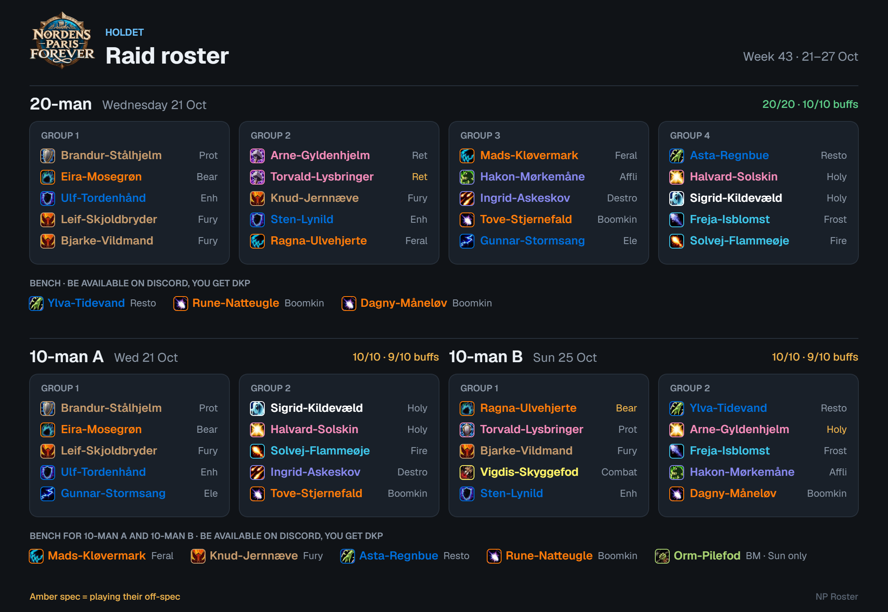

*Alle billeder viser et opdigtet hold med testdata.*

## Kom i gang

Værktøjet ligger på **https://nordens-paris.github.io/tools/raid-roster/**. Log ind med din Google-konto. Darkfade giver hver officer adgang til deres raidhold; uden adgang kan man ikke se noget. Hvert hold (fx Holdet, Frat-Boiz og Pejsen) har sine egne data, og hold kan ikke se hinandens.

- **Officer:** kan se og rette alt i holdets værktøj.
- **Viewer:** kan kigge, men ikke ændre noget. Øverst til højre står **Shared · view only**.
- **Første login:** du vælger det navn, de andre officerer ser i loggen (fx dit Discord- eller karakternavn). Google-navnet bliver ikke brugt.
- **Flere hold:** er du på flere hold, vælger du hold ved login, og **Switch team** øverst skifter. **Sign out** logger ud.

Opsætningen af Firebase og adgangen står i [web/SETUP.md](web/SETUP.md).

En typisk uge:

1. **Week → Create week.** En uge går fra reset onsdag til tirsdag og hedder efter ugenummeret (fx "Week 43"). Raiddagene fra Settings lægges ind af sig selv.
2. **Importér tilmeldingerne:** **Import signups** på hver raiddag, eller **Import all days** for alle events på én gang.
3. **Suggest plan → Use this plan.** Justér ved at trække spillere rundt, og vælg evt. bænken selv under **Decide the bench**.
4. **Share the roster:** kopiér billedet eller teksten til Discord og addon-strengen til raidlederen.
5. **Mark week as final**, når ugen er spillet, så den tæller med i bænk-rotationen.
6. Efter raidet: importér fremmødet under **Attendance**.

## Week

### This week (tjekliste)

Øverst på ugen er en række mærker, der viser, hvad der er gjort, og hvad der mangler: tilmeldinger importeret pr. dag, hvert raid planlagt og fuldt, postet på Discord, fremmøde for de raids, der er spillet, og om ugen er markeret final. Grøn = klaret, gul = noget at gøre nu, grå = senere. Klik på et mærke for at komme derhen.

**Forældede tilmeldinger:** er en kommende raiddag importeret for mere end et døgn siden, bliver mærket gult ("re-import"), og dagens kort viser "Imported 2 days ago" i gult.

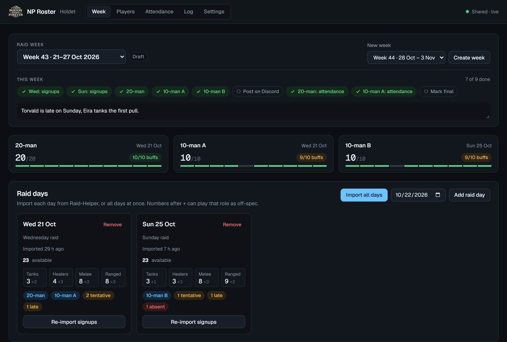

### Noter

Under tjeklisten øverst er et felt til **officer-noter for ugen** (fx "vores off-tank kommer sent søndag"), og hvert raid har sit eget notefelt øverst (fx "Fire resist på Rag"). Noterne gemmes, når du forlader feltet, ses kun i værktøjet (ikke på Discord eller i addon'et) og logges, så de kan fortrydes.

### Raid days

- **Add raid day** tilføjer en dato i ugen; **Remove** fjerner dagen og tømmer de raids, der lå på den (to klik).
- Hver dag viser, hvor mange der er tilgængelige, fordelt på tanks, healere, melee og ranged. Tallet efter **+** er dem, der kan tage rollen som off-spec. Mærkerne viser, hvilke raids der ligger på dagen, og hvor mange der er tentative, late, bench eller absent.
- **Import signups:** indsæt event-linket → **Open event data** → Ctrl+A, Ctrl+C på den side → indsæt i feltet → **Import signups**. Spillere oprettes automatisk ud fra Discord-tilmeldingen, med main- og off-spec. Skabeloner, der kun viser Tank, Melee, Ranged og Healer (fx `wowforever`), virker også: klassen findes ud fra spec'en. Ligger eventet på en anden dato end dagen, siger værktøjet til.
- **Import all days:** indsæt flere events efter hinanden. Hvert event lægges på dagen med samme dato; mangler dagen i ugen, oprettes den. Events uden for ugen springes over.
- **Re-import signups** henter nye tilmeldinger. Ændrer det noget for et roster, der allerede er lavet, viser raidet det (se "Ændrede tilmeldinger" nedenfor).

### Availability

En tabel over alle spillere og deres status på hver raiddag. Status kan rettes med rullemenuen, fx hvis nogen har meldt fra i Discord uden at rette i Raid-Helper: Signed up, Tentative, Late, Bench, Absent eller Not signed up. Hold musen over menuen for at se, hvilken spec de har tilmeldt sig som. En status, en officer har sat, får en blå streg i venstre side og bliver stående, når dagen importeres igen, indtil nogen ændrer den. Tabellen kan klappes sammen.

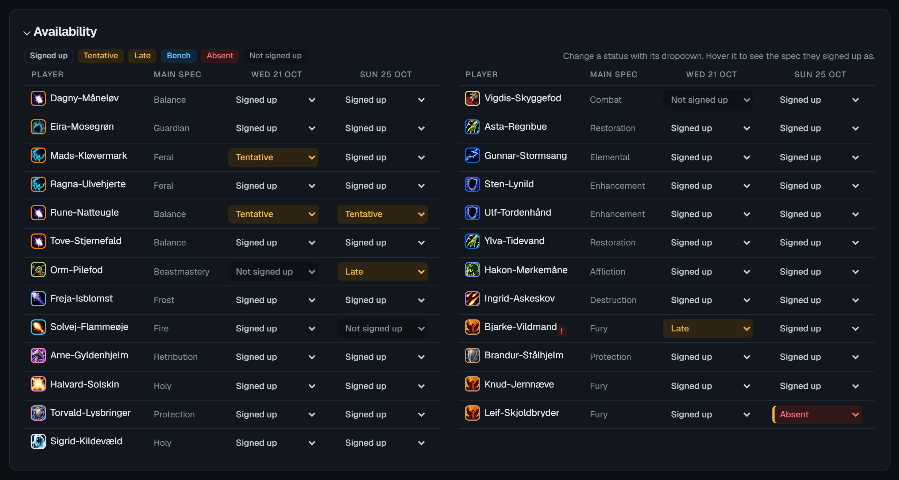

### Plan the week

**Suggest plan** prøver alle måder at fordele raidene på raiddagene og viser den bedste (**Recommended**) og op til to alternativer, hver med antal spillere og buffs pr. raid og hvilke buffs der mangler. **Use this plan** lægger rosterne ind.

- **Max raids per day** (Settings) bestemmer, hvor mange raids der må ligge på samme dag.
- Vælger du selv dagen for et raid, bliver det **Pinned**: Suggest plan beholder det på den dag og flytter kun de andre. **Unpin days** frigiver dem igen.

### Sådan vælges rosteret

Optimeringen vælger i denne rækkefølge, og et højere trin vinder altid over alle lavere tilsammen:

1. **Roller:** præcis det antal tanks, raidstørrelsen kræver (inkl. off-tank), og healere mellem min og maks, helst på målet. Faste tanks (se Players) får tank-pladserne først.
2. **Never bench:** spillere med Never bench kommer med, når de er tilmeldt, medmindre det bryder tank- og healer-reglerne.
3. **Buff-prioriteten** fra Settings. Øverst vinder: når der ikke er nok til alle, ryger buffs nederst på listen først.
4. **DPS-pladserne** går efter bænk-retfærdighed, prioritet, parse og tilmelding (tentative, late og "bench" i Raid-Helper trækker ned), off-spec trækker ned, og en blanding af specs foretrækkes frem for fx fire Fury warriors (alle Mage-, Warlock-, Hunter- og Rogue-specs tæller som én). Ved lige stand vinder den, der tilmeldte sig først.

Raids af samme størrelse er samme lockout: ingen kommer med i begge 10-mænd. Optimeringen fordeler spillerne mellem dem, så de får omtrent lige mange buffs (vægten **Raid balance**), og er der for få spillere til begge, fordeles de ligeligt.

**Faste 10-mands-hold:** optimeringen prøver at holde spillere, der var på samme 10-mand sidste gang, sammen igen (vægten **Fixed teams**). Det er par af spillere, der tæller, ikke navnet A eller B, så holdene følger med, også når de to 10-mænd bytter dag. Buffs og roller går stadig forud. Hver 10-mand viser fx **8/10 same team**: hvor mange i rosteret der spillede sammen sidste gang. I en simulering på det nuværende roster (12 uger, 90 % fremmøde) steg andelen fra 51 % uden vægten til 80 % med standardvægten 400.

**Bænk-retfærdighed:** hver uge inden for de sidste 8, hvor en spiller sad på bænken i en raidstørrelse, giver et "tilgodehavende", der vægter mindre, jo længere det er siden (×0,85 pr. uge). En uge, hvor de spillede, trækker en smule fra. En lockout tæller én gang pr. uge. Kun uger, der er markeret final, eller raids med registreret fremmøde tæller med.

### Raids

20-manden har sit eget kort. De to 10-mænd vises som ét lockout-kort med begge rosters side om side, hver med sin egen dag, én fælles bænk og én fælles **Decide the bench**.

- **Dag:** rullemenuen øverst flytter raidet til en anden dag eller tager det af planen (**Not scheduled**). Vælger du en dag for et tomt raid, fyldes det med det samme.
- **Mærkerne** viser antal spillere, rollerne (rød, hvis tanks eller healere ikke passer), dækkede buffs og hvem der sidst rettede raidet. Buff-listen viser hver buff med flueben eller kryds; hold musen over for at se, hvem der giver den.
- **Mangler en buff**, som en på bænken kan give, står det under mærkerne, med et hint om at trykke **Re-optimize** eller fjerne en officers valg.
- **Re-optimize** vælger rosteret igen på den nuværende dag (for lockouten: begge 10-mænd) og beholder de spillere, en officer har placeret.
- **Explain** åbner "Why this roster": tanks og healere med begrundelse (fast tank, off-spec, holdt inde), hvilke buffs der mangler og hvorfor (ingen tilgængelig, spiller i den anden 10-mand, holdt ude eller på bænken), off-specs, officerernes valg, hvor meget af holdet der er det samme som sidst, hvorfor hver bænkspiller sidder over, og hvem der er væk eller har meldt fra. **Copy for Discord** kopierer det hele som tekst.
- **Re-sort groups** laver grupperne om ud fra rosteret uden at ændre, hvem der er med.
- **Clear picks (… kept in, … kept out)** fjerner alle officerernes valg i raidet, så optimeringen bestemmer frit igen (to klik).
- **Off-spec:** en spec i gul/amber betyder, at spilleren er med på sin anden spec.

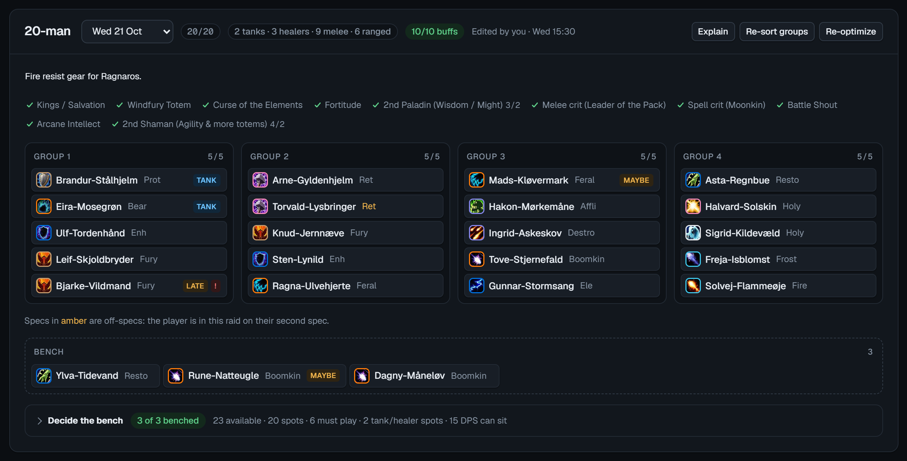

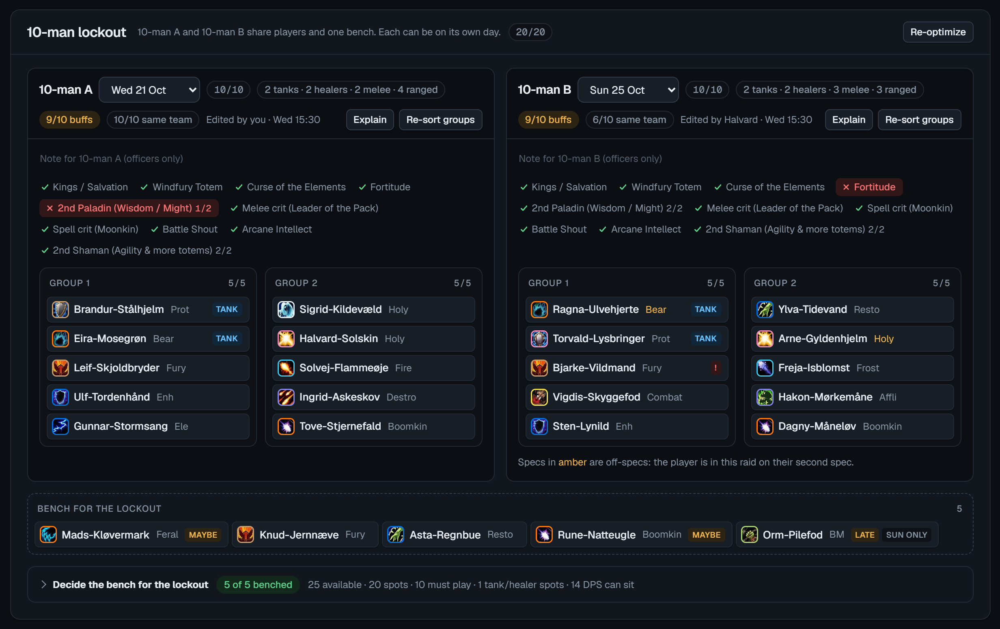

**Grupper:** fulde melee-grupper (tanks i gruppe 1), fulde ranged-grupper og en healergruppe med Mana Tide; Shadow Priest og andre casters fylder op hos healerne. Enhancement-shamaner spredes over melee-grupperne. Af hensyn til Tremor Totem kommer den første shaman altid i gruppe 1 hos tanks, den anden hos healerne (en Restoration Shaman, hvis der er en) og den tredje i gruppe 2. **Re-sort groups** bruger også reglerne på et roster, der allerede er lavet.

### Flyt spillere

- **Træk og slip** spillere mellem grupper, bænken og de to 10-mænd. Slipper du en spiller oven på en anden, bytter de plads. Den, du flytter ind, bliver låst i raidet (hængelås-ikon), og den, du flytter på bænken, holdes ude, så Re-optimize respekterer det.
- **Klik på en spiller** (eller Tab hen til dem og tryk Enter) for en bjælke nederst med:
  - **spec:** hvilken af deres specs de spiller i raidet
  - **G1, G2 …, Bench:** flyt til en gruppe eller på bænken
  - **regel for Re-optimize:** Optimizer decides, Keep in this raid eller Keep out of this raid
  - **Player card:** åbner spillerkortet (se nedenfor)

  Esc lukker bjælken.
- **Ikoner på spillerne:** hængelås = holdt inde af en officer, **tank** = fast tank, **maybe**/**late** = tilmeldt tentative/late, **bench** = tilmeldt som bænk, **Wed only** = kun tilmeldt nogle af lockoutens dage, rødt **!** = upålidelig de sidste 8 uger (se Pålidelighed). Hold musen over en spiller for spec, buffs og hvorfor de evt. sidder over.

### Ændrede tilmeldinger

Importerer du igen, efter et roster er lavet, viser raidet en gul linje med, hvem der har meldt fra men står på rosteret, hvem der har ændret status, og hvem der er kommet til (de står på bænken). **Re-optimize** bygger rosteret om; **Dismiss** fjerner beskeden.

### Bænk

Bænken er alle, der er tilgængelige på dagen, men ikke spiller. De skal være tilgængelige på Discord og klar til at logge på, så får de DKP. De to 10-mænd har én fælles bænk, også når de ligger på forskellige dage. Rækkefølgen er den, addon'et kalder ind i: den, der har mest til gode, først.

### Decide the bench

Under hvert raid (for 10-mændene: én for hele lockouten) kan officeren selv vælge, hvem der sidder over. Overskriften viser, hvor mange der skal sidde, og hvor mange der er sat.

- **Tavlen** viser for hvert raid tanks, healere og hver buff med bænken, som den er krydset af lige nu: grøn = nogen kan sidde, blå = lige nok (behold dem), rød = mangler, men en på bænken kan give den, stiplet = ingen tilmeldte kan give den.
- **Tabellen** deler spillerne op i:
  - **Never bench** og **Needed**: bringer en buff, eller er tank/healer, som ingen andre tilmeldte kan dække
  - **Tank-/healer-pladser**: sidder de over, tager en anden pladsen, måske på off-spec
  - **DPS i bænk-rækkefølge**: #1 står først for tur til at sidde over. Dem, der er de eneste med en buff, kommer sidst.
- **If benched** viser, hvad raidet mister, hvis spilleren sidder over ("Last …"), eller "Safe to bench". For dem på bænken står der, hvad de ville tilføje.
- Derudover ses bænk de sidste 8 uger (udfyldt = bænket), fremmøde i procent, parse og tilmeldingsstatus.
- **Apply bench** holder de afkrydsede ude af alle lockoutens raids og bygger rosterne om. **Reset** glemmer krydserne. Bjælken advarer, hvis bænken koster en buff eller rolle, går imod Never bench, eller hvis der er sat for mange eller for få.

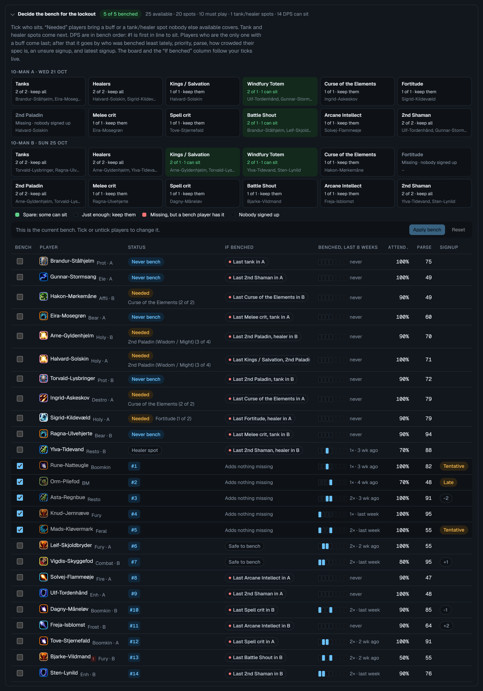

### Share the roster

- **Roster image:** et billede af alle raids med grupper, spec-ikoner, klassefarver og bænken, lavet til Discords mørke tema. **Copy image** eller **Save image**.
- **Discord text:** samme indhold som tekst. Med **@mention players** bliver spillerne pinget (spillere fra Raid-Helper har deres Discord-ID).
- **Addon string:** til addon'et, med grupper, klasser, specs og bænken i kalde-rækkefølge.
- Når du har kopieret noget, husker ugen det (**Posted …**). Ændres rosteret bagefter, står der **Changed since posted**, så du ved, at det skal postes igen.
- **Mark week as final** gemmer bænkene, så ugen tæller i bænk-rotationen. **Back to draft** åbner den igen.
- **Record attendance from the plan:** hvis addon'et ikke blev brugt, registreres fremmødet ud fra rosteret og bænken.
- **Delete week** sletter ugen (to klik). Den kan hentes tilbage under Log.

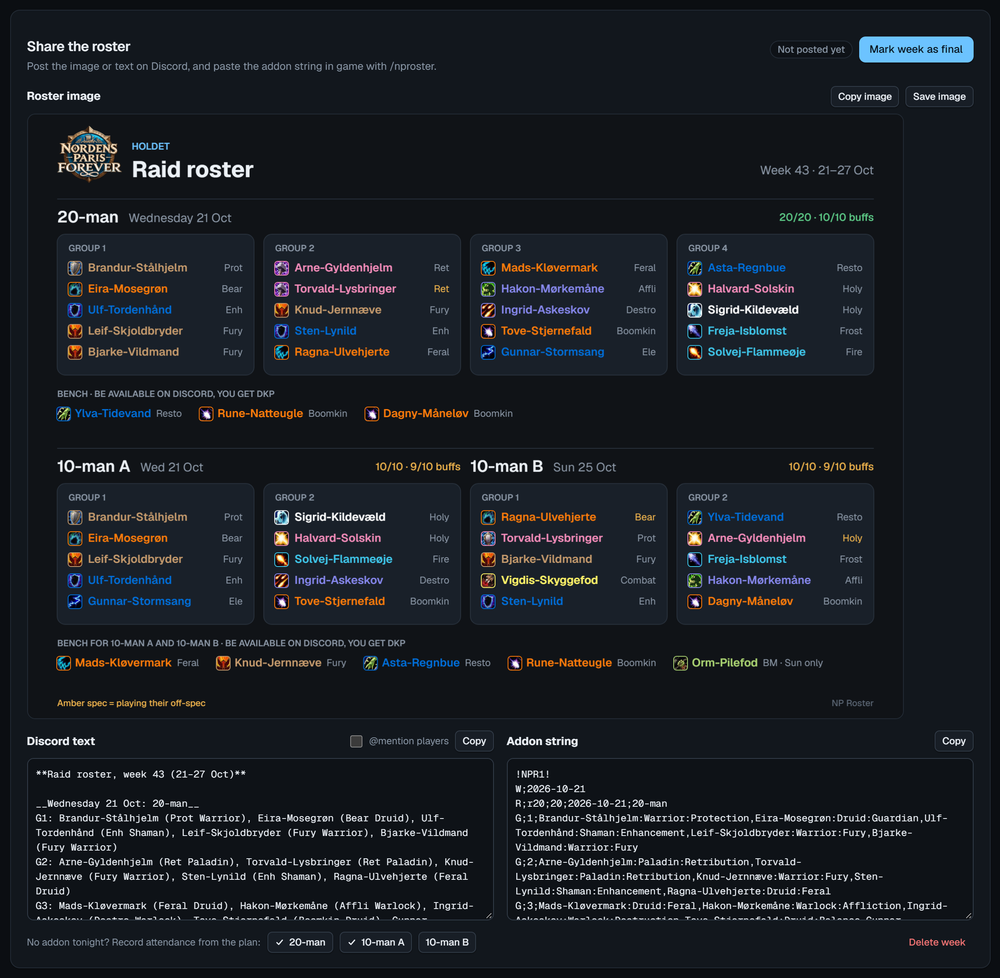

### Gemning

Alt gemmes med det samme. Øverst til højre står **Saving…** med en gul prik, mens en ændring er på vej til databasen, og derefter **Shared · live** igen. Lukker man siden, før alt er gemt, spørger browseren, om man vil blive.

### Lyst eller mørkt tema

Knappen med sol/måne øverst til højre skifter mellem lyst og mørkt tema. Valget huskes i din browser og gælder kun for dig. Har du ikke valgt noget, følger siden temaet i claude.ai eller på din computer. Roster-billedet til Discord er altid mørkt.

### Fortryd

**Undo** øverst eller **Ctrl+Z** fortryder din seneste ændring i ugen, også efter en genindlæsning; tryk igen for at gå et skridt længere tilbage. Officerer kan rette i hver sit raid samtidig uden at overskrive hinanden. Se **Log** for at fortryde ældre ændringer eller andres.

## Spillerkort

Hele historien om én spiller i et vindue: klik på navnet i Availability, Decide the bench eller Attendance, på **Card** under Players eller på **Player card** i bjælken nederst, når en spiller er valgt. Esc eller et klik ved siden af lukker det. Kortet viser:

- spec, off-spec, prioritet, Never bench, faste tank-størrelser og om spilleren er inaktiv
- fremmøde i procent, antal spillede, bænk, no-shows, afbud efter roster, tentative/late-tilmeldinger og parse
- bænk-retfærdighed pr. raidstørrelse: bænk de sidste 8 uger og hvor meget de har til gode
- hvilke specs de har spillet, og hvor ofte
- planlagt fravær og spillerens karakterer (main og alts)
- uge for uge: tilmelding pr. dag (med "dropped" ved afbud efter roster) og hvad der skete i hvert raid: spillede (med spec), bænk med begrundelsen, no-show eller planlagt

Kortet er godt til at svare på "hvorfor sad jeg over igen?". Indstillingerne rettes stadig under Players.

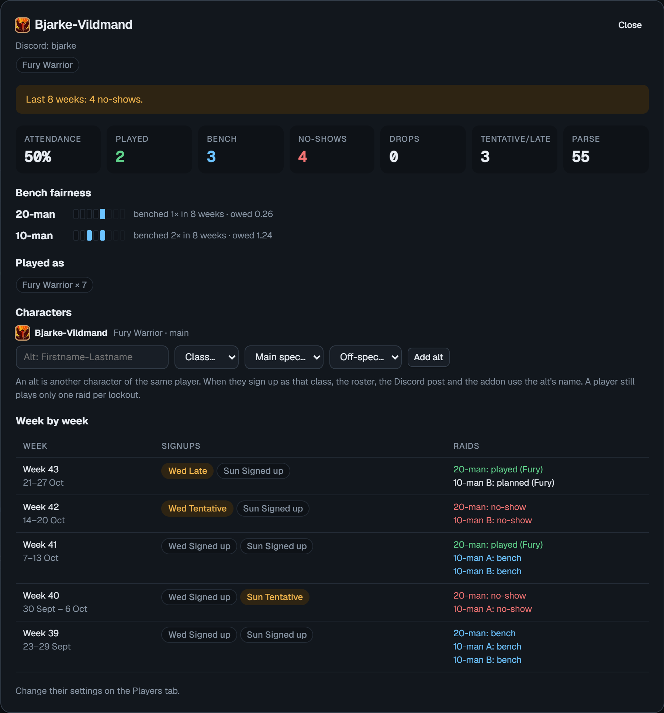

## Pålidelighed

Værktøjet holder selv øje med to ting:

- **No-show:** spilleren var planlagt til at spille eller sidde på bænken, men gjorde ingen af delene (fra fremmødet). Tæller én gang pr. lockout pr. uge.
- **Afbud efter roster (drop):** spilleren stod på et roster, og ved en ny import eller en rettelse i Availability er de ikke længere tilgængelige den dag. Melder de sig til igen, forsvinder afbuddet. Importen siger til, hvem der har meldt fra.

En no-show giver 1 point og et afbud ½ point. Har en spiller 2 point eller mere inden for de sidste 8 uger, får de et rødt **!** på spillerchippen, under Players, i Attendance og i Decide the bench, med forklaringen, når man holder musen over. Vægten **Reliability** under Settings bestemmer, om pointene også trækker ned, når DPS-pladserne fordeles. Den står på 0 fra start, så den kun advarer.

## Players

### Away (fraværskalender)

Under Players kan man skrive planlagt fravær ind: spiller, fra-dato, til-dato og en note (fx "ferie"). På de dage tæller spilleren som absent i alle raids, også før de har tilmeldt sig i Raid-Helper. I Availability står de med en gul streg og datoerne, når man holder musen over. Sætter en officer status i hånden, vinder den over fraværet. Fravær, der er slut, forsvinder af sig selv fra listen.

### Alts

På spillerkortet under **Characters** kan man tilføje en spillers alts (navn, klasse, main- og off-spec). Tilmelder spilleren sig som alt'ens klasse, bruger rosteret, Discord-teksten, billedet og addon-strengen alt'ens navn, og chippen er mærket **alt**. Fremmøde-strenge fra addon'et genkender også alt-navne. En spiller spiller stadig kun ét raid pr. lockout, uanset hvilken karakter.

### Spillerliste

Spillere oprettes, når de tilmelder sig, og kan også tilføjes i hånden nederst (**Add player**).

| Felt | Betydning |
|---|---|
| Character | Karakternavnet, som addon'et inviterer efter (se nedenfor). **guess** = gættet ud fra Discord. |
| Discord | Navnet på Discord-serveren. |
| Class, Main spec, Off-spec | Bruges, når en tilmelding ikke siger andet. Spillere uden klasse eller main spec kan kun planlægges, når de tilmelder sig med en. |
| Priority | +2 (core) til -2 (trial). Ekstra vægt, når DPS-pladserne fordeles. |
| Avg parse | Gennemsnitlig parse 0-100, skrives i hånden indtil videre. |
| Tanks in | De raidstørrelser, spilleren er fast tank i (fx 20 og 10 for main tanks, kun 10 for 10-mands-tanks). De får tank-pladserne først; ellers spiller de deres DPS-spec. |
| Never bench | Spiller altid, når de er tilmeldt. Kun tank- og healer-reglerne går forud. |
| Active | Inaktive spillere ignoreres i planlægningen og i fremmødet. |
| Notes | Fri tekst. Vises også på spillerkortet. |
| Card | Åbner spillerkortet. Et rødt **!** betyder upålidelig. |

Krydset sletter spilleren (to klik). Import fra Warcraft Logs kommer efter launch, når der findes rigtige WoW Forever-logs (der er en pladsholder).

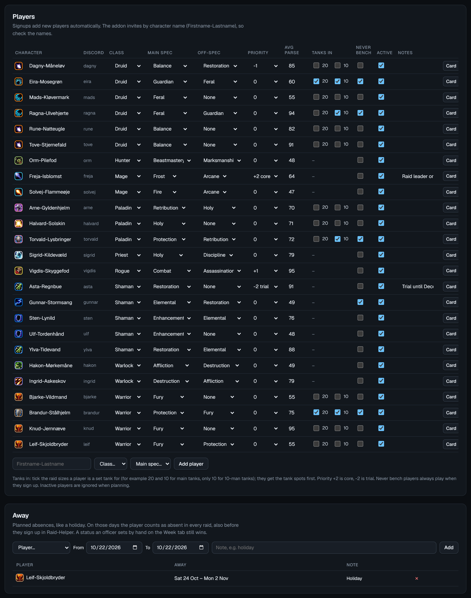

### Discord-navn og karakternavn

Spillere genkendes på deres Discord-ID, så navneskift ødelægger ikke historikken. Karakternavnet findes sådan:

1. **Gæt:** ud fra Discord-kaldenavnet på serveren. WoW Forever-navne er `Fornavn-Efternavn`, så en bindestreg inde i et ord hører til navnet. Står der et skilletegn med mellemrum, `/` eller `|`, bruges det sidste stykke: `Jonas | Aria-Stormwind` → `Aria-Stormwind`. Gættet følger med, hver gang du importerer. Aftal derfor kaldenavne som `Navn | Fornavn-Efternavn` eller bare `Fornavn-Efternavn` efter launch, så opdateres det af sig selv.
2. **Rettet i hånden:** skriv navnet under Players. Så er det låst.
3. **Fra første raid:** står der navne i fremmøde-strengen, som værktøjet ikke kender, spørger det, hvem de tilhører, og gemmer navnet på spilleren.

Store/små bogstaver og mellemrum i stedet for bindestreg betyder ikke noget, når navne sammenlignes.

## Attendance

- **Import attendance:** efter raidet skriver raidlederen `/nproster` i spillet, åbner Attendance og kopierer strengen; indsæt den her. Alle på den planlagte bænk tæller som bænk. Kender værktøjet ikke et navn fra spillet, vælger du, hvem det er, og navnet gemmes som spillerens karakter.
- **Check recent raids:** de seneste tre ugers raids med fremmøde. Klik på en spiller for at skifte mellem played, bench og no-show, fx en bænkspiller, der ikke var til at få fat i på Discord.
- **Bench rotation:** hvor mange gange hver spiller har siddet over pr. raidstørrelse (fx "2 / 9" = bænket 2 af 9 lockouts), i alt, andel og hvornår sidst. Tæller alle uger markeret final og alle raids med fremmøde. **Copy for Discord** giver en kort liste til at vise guilden, at rotationen er fair.
- **Tabellen:** hver uge tæller 20-manden og 10-mands-lockouten én gang hver. Spillet eller bænk (tilgængelig) tæller som fremmøde. **P** = spillede, **B** = bænk, **✕** = planlagt, men kom ikke, **·** = ikke med. Desuden antal sene og parse.

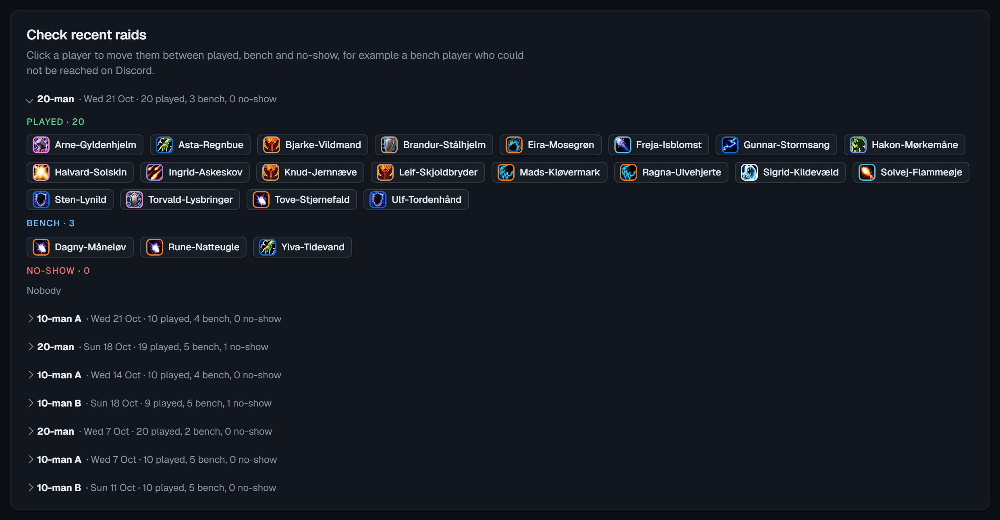

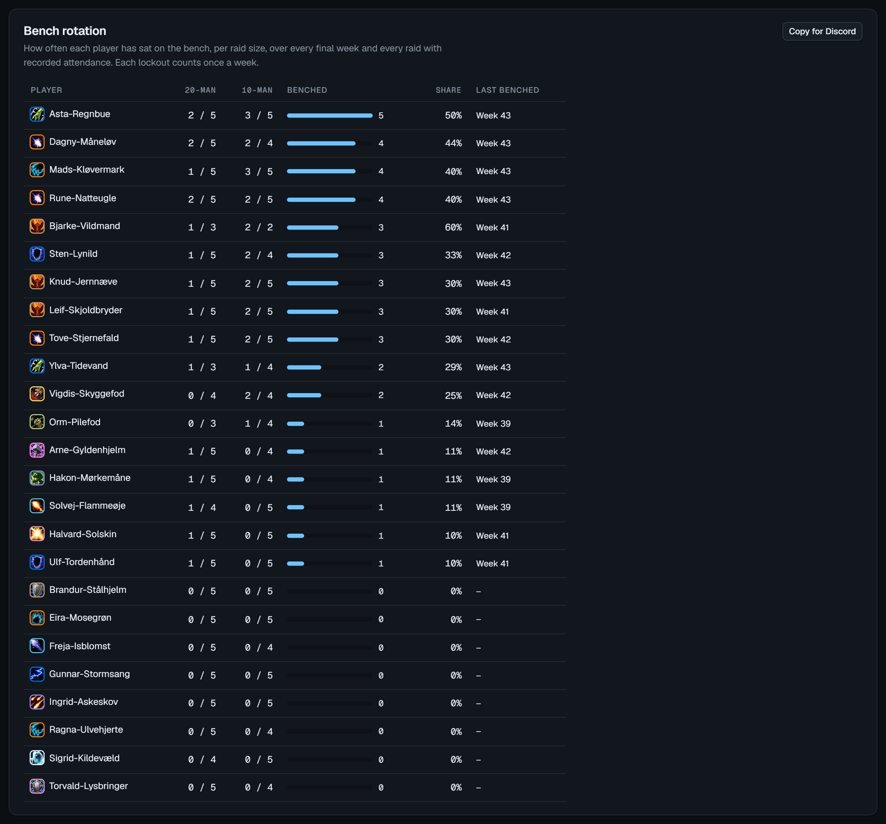

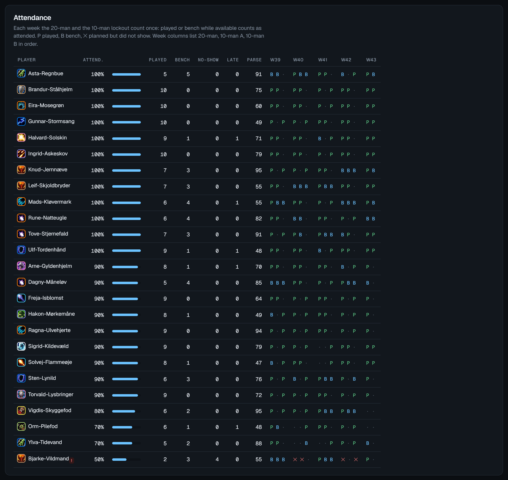

## Log

Alle ændringer på tværs af uger (rosters, flyt, bænk, tilmeldinger, import, fremmøde, noter, spillere og indstillinger), nyeste først, med filter pr. uge (eller "Players and settings") og pr. officer. Hver linje viser, hvilke dele den ændrede (fx "20-man", "Signups Wed 21 Oct"). Hver ændring gemmes med, hvordan det så ud før, så den kan rulles tilbage:

- **Undo** fortryder netop den ændring. Har en anden officer rettet samme raid eller dag bagefter, nægter den og siger hvem, så ingen andens arbejde forsvinder i stilhed.
- **Restore to before** sætter ugen tilbage til, som den var lige før ændringen, og ruller dermed også alle senere ændringer i ugen tilbage. Første klik markerer de ændringer, der rulles tilbage; andet klik udfører det. For en ændring af en spiller eller indstillingerne gælder det kun den spiller eller indstillingerne.
- Begge dele logges selv og kan fortrydes igen (en fortrydelse af en fortrydelse er en "Redid"). Fortrudte og tilbagerullede linjer står nedtonet med, hvem der gjorde det.
- En slettet uge kan hentes tilbage på samme måde. Spillere, som en import har oprettet, bliver liggende på spillerlisten, når importen fortrydes.
- Historikken gemmes i 120 dage (højst de nyeste 1.000 ændringer); ældre ændringer slettes automatisk. Ændringer fra før historikken fandtes, står som "Log only" og kan ikke fortrydes.

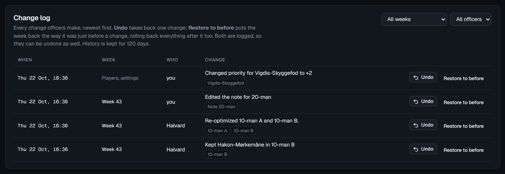

## Settings

- **Buff priority:** listen over buffs, øverst vigtigst. Hver linje har navn, klasse, specs (tom = alle specs) og **Need** (hvor mange af den klasse/spec der skal til, fx 2 for "2nd Paladin"). Pilene ændrer rækkefølgen, **Add buff** tilføjer en.
- **Raid sizes and roles:** for 20- og 10-mand: størrelse, antal tanks (inkl. off-tank) og healere min/maks/mål.
- **Team name:** holdets navn, som står i topbjælken og på roster-billedet.
- **Raids each week:** raidene med navn og størrelse. Raids af samme størrelse deler lockout. **Max raids per day** og **Default raid days** for nye uger.
- **Optimizer weights:** hvor meget hvert hensyn vejer, når DPS-pladserne fordeles (roller og buffs går altid forud):

| Vægt | Betydning |
|---|---|
| Bench fairness | Pr. tilgodehavende bænk. Højere får bænkede tilbage hurtigere. |
| Player priority | Pr. trin i Priority. |
| Parse | Pr. parse-point. Ved 2 slår en 90-parse en 40-parse med 100. |
| Off-spec penalty | Prisen for at bede nogen spille off-spec. |
| Tentative / Late penalty | Prisen for at vælge en, der er tilmeldt tentative / late. |
| Signed up as bench | Prisen for at vælge en, der har tilmeldt sig som bænk. |
| Raid balance | Pr. buff i forskel mellem raids af samme størrelse. Ved 1500 kan den bytte den lavest prioriterede buff for balance, aldrig en højere. 0 slår det fra. |
| Reliability | Pr. no-show de sidste 8 uger (et afbud efter roster tæller halvt). 0 = kun advarsel. |
| Fixed teams | Pr. spiller, der holdes sammen med sidste uges holdkammerater, når raids af samme størrelse deler spillerne. Ved 400 koster det ca. 800 at flytte én spiller, mindre end den lavest prioriterede buff. 0 slår det fra. |
| Spec spread | Pr. ekstra spiller af samme spec (den 4. Fury warrior koster 3×). 0 slår det fra. |

Standardværdierne (Bench fairness 600, Player priority 300, Fixed teams 400, Raid balance 1500) er valgt ud fra en simulering af 12 uger med 90 % fremmøde på det nuværende roster. Med dem kom ingen på bænken mere end 4–5 uger i træk, mens buffs og faste hold holdt sig som før. Hvert trin i Priority flytter en DPS' chance for at spille med ca. 7–10 procentpoint (−2: ca. 60 %, 0: ca. 80 %, +2: ca. 93 %). Player priority over ca. 400 kan holde en spiller med −2 på bænken i mange uger i træk.

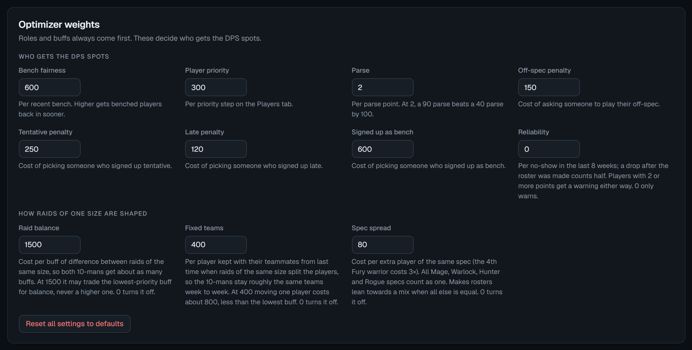

- **Reset all settings to defaults** (to klik).

### Backup

**Save backup** gemmer alt (spillere, uger, fremmøde, indstillinger) som en JSON-fil. **Restore from file** lægger en backup tilbage og erstatter alt for alle officerer (to klik). En gendannelse kan fortrydes under Log.

## Filer

- `np-roster.html`: siden (layout og styles)
- `core.js`: Raid-Helper-import, optimering, grupper og streng-formater (ingen DOM, kan testes uden browser)
- `app.js`: brugerflade, fælles database og historik
- `icons/`: Blizzards klasse- og spec-ikoner (fra Wowheads ikonserver) og guildens emblem (`emblem.png`)
- `images/`: skærmbillederne i denne README (et opdigtet hold med testdata)
- `web/`: kørslen på Firebase og GitHub Pages: login og database (`firebase-backend.js`), sikkerhedsreglerne (`firestore.rules`), projektets konfiguration (`firebase-config.js`), byggescriptet (`build.py`) og en falsk Firebase til lokale tests (`fake-firebase.js`)

## Netværk og data

Siden henter skrifttyper fra Google Fonts og Firebase fra Google. Raid-Helper-dataen kopierer du ind i hånden. Alt gemmes i Firebase (Firestore), og sikkerhedsreglerne i `web/firestore.rules` sørger for, at kun holdets officerer og viewers kan læse holdets data. Der ligger ingen spillerdata i repoet.

Værdierne i `web/firebase-config.js` er ikke hemmelige: de fortæller kun browseren, hvilket Firebase-projekt den skal tale med. Sikkerheden ligger i reglerne.

Værktøjet kan stadig køre som en Claude-artifact: `app.js` bruger samme database-kald begge steder, og `web/firebase-backend.js` oversætter dem til Firestore.

## Vedligeholdes af

Darkfade
