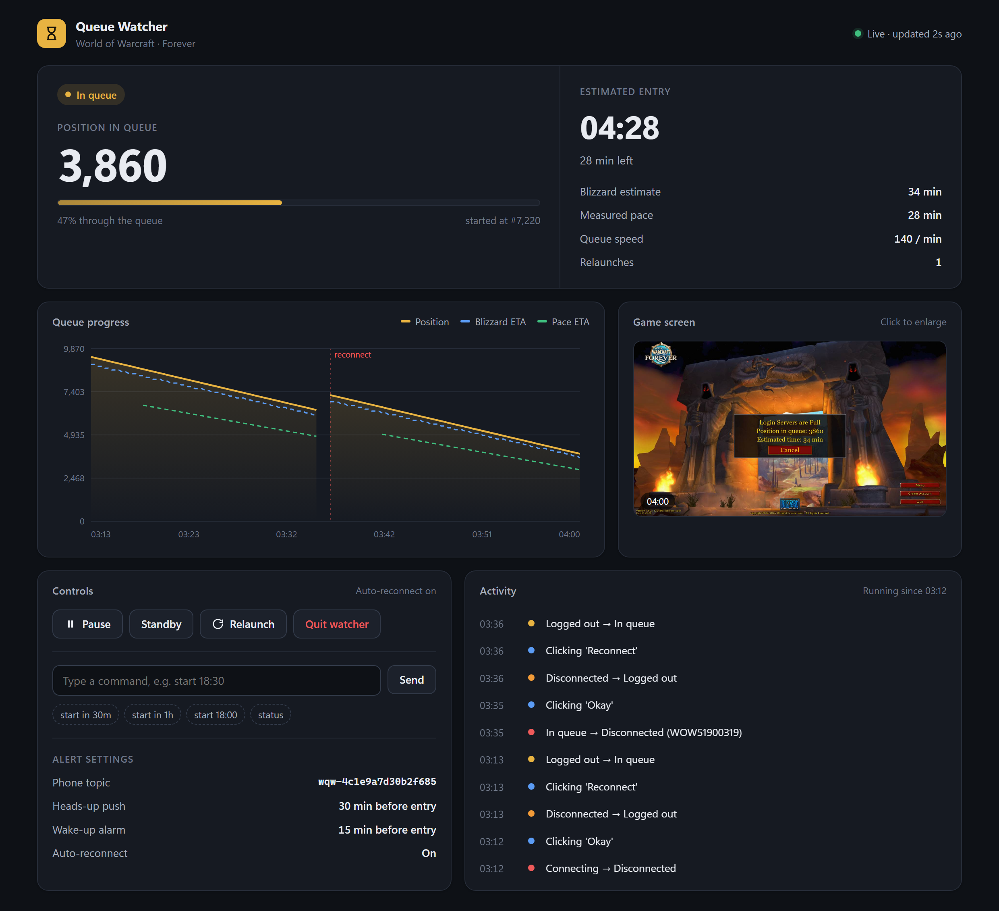

# WoW Queue Watcher

Holder øje med login-køen i WoW Forever, sender din plads og forventet indgangstid til telefonen (via den gratis app [ntfy](https://ntfy.sh)) og vækker dig med en alarm, når køen er ved at være færdig.

Programmet tager skærmbilleder af spilvinduet og læser dem med Windows' indbyggede tekstgenkendelse. Det læser eller ændrer aldrig spillets hukommelse eller filer.



*Eksempel fra en simuleret kø med auto-reconnect slået til og et opdigtet ntfy-emne. Se også [alarmen ved 15 minutter](docs/dashboard-alarm.png).*

## Auto-klik er slået fra som standard

Programmet kan selv klikke dig tilbage i køen efter et disconnect og genstarte spillet ved crash. Blizzards regler tillader dog ikke automatisering, så den funktion er **slået fra**. Ud af boksen overvåger programmet kun og sender alarmer.

Vil du have den, så sæt `enabled = true` under `[reconnect]` i `config.toml`. Det er på eget ansvar. `auto_enter_world` virker også kun, når `enabled = true`.

Kommandoer du selv sender fra telefonen (`enter`, `reconnect`, `start`) virker stadig, fordi det er dig, der beder om dem.

## Kom i gang

**Den nemme måde:** hent den færdige zip-fil under [Releases](https://github.com/nordens-paris/tools/releases), pak den ud og følg `Vejledning.html`.

**Fra kildekoden** (kræver Python 3.11 eller nyere):

```bash
py -3 -m pip install -r requirements.txt
```

Dobbeltklik derefter på `start.bat`. Første gang laves `config.toml` ud fra `config.example.toml`, og dit private ntfy-emne (topic) bliver genereret. `config.toml` er udelukket fra git, så dit emne aldrig ender på GitHub.

| Fil | Gør |
|---|---|
| `start.bat` | Starter WoW og overvåger køen |
| `standby.bat` | Venter på `start` fra telefonen |
| `start-beta.bat` | Som `start.bat`, men til betaen |
| `stop.bat` | Stopper programmet, også hvis det kører uden vindue |

Alle kommandoer, tjekliste til natten og fejlfinding står i [docs/Vejledning.html](docs/Vejledning.html). Tekniske detaljer (på engelsk) står i [docs/technical.md](docs/technical.md).

## Byg en release

`release-files/` indeholder de `.bat`-filer, der skal ligge ved siden af `WoWQueueWatcher.exe` i zip-filen. Exe-filen bygges med PyInstaller ud fra `watch.py` og lægges på en GitHub Release, ikke i selve repoet.
